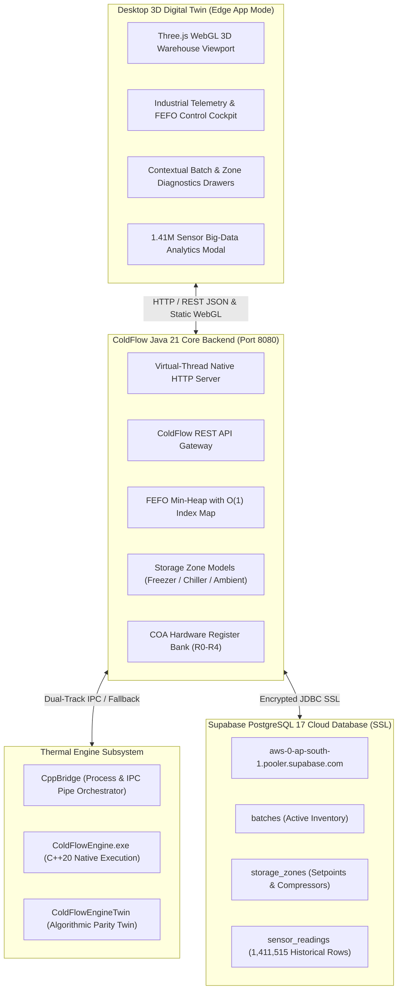

# ColdFlow: Smart Cold-Chain Warehouse 3D Digital Twin
### Autonomous Cold-Chain Storage, Algorithmic FEFO Logistics, C++ Thermal Dynamics & Big-Data IoT Analytics

[](https://openjdk.org/)
[](https://isocpp.org/)
[](https://threejs.org/)
[](https://supabase.com/)
[](docs/TECHNICAL_DOCUMENTATION.md)
[](#quality-assurance--testing)

---

## ❄️ Overview

**ColdFlow** is an industrial-grade **3D Digital Twin and Warehouse Management System (WMS)** built for high-stakes cold-chain logistics. In cold-chain storage (pharmaceuticals, dairy, meat, frozen vaccines), thermal breaches or improper inventory rotation can ruin inventory worth millions of dollars.

ColdFlow solves this by transforming previously fragmented subsystems into **ONE unified, hardware-accelerated desktop application**:
- **3D Spatial Simulation:** Realistic Three.js WebGL industrial warehouse with teardrop pallet racks, Euro-pallets, procedural carton barcode labels, sub-zero cold vapor particle emitters, spinning evaporator fans, and Autonomous Guided Vehicles (AGV).
- **Core Orchestration:** High-concurrency Java 21 backend utilizing Project Loom virtual threads and zero external web framework bloat.
- **Thermal Processing Engine:** Dual-track C++20 sliding-window temperature controller (`ColdFlowEngine.exe`) backed by a mathematically verified algorithmic twin (`ColdFlowEngineTwin.java`).
- **Logistics Intelligence:** First-Expired-First-Out (FEFO) scheduling powered by an indexed min-heap offering $O(1)$ next-batch resolution.
- **Big-Data Environmental IoT Pipeline:** Real-time server-side SQL downsampling and statistical anomaly detection over **1,411,515 historical sensor records**.

---

## 🏛️ System Architecture

ColdFlow launches as a native desktop application in Microsoft Edge App Mode (`--app`), orchestrated by an automated PowerShell process supervisor.



---

## 🚀 Key Technical Innovations

### 1. One-Click Native Desktop Window
ColdFlow launches with a single click via `Run-ColdFlow.bat`. A native process supervisor compiles source code, verifies cloud database connectivity, starts the backend on `127.0.0.1:8080`, and launches a borderless, dedicated window via Edge App Mode. When closed, it performs a graceful shutdown with **zero orphaned background processes**.

### 2. Dual-Track C++20 Thermal Engine & Parity Twin
- **Native C++ Engine (`ColdFlowEngine.exe`):** Compiles natively and runs via IPC pipes, maintaining rolling 10-sample circular buffers, calculating thermal error deltas, and evaluating hysteresis.
- **Java Algorithmic Twin (`ColdFlowEngineTwin.java`):** An algorithmic duplicate providing identical mathematical output if host security policies (such as AppLocker/WDAC) block native execution.
- **Parity Test Harness:** An 18/18 automated test suite verifies 100% output equivalence between Java and C++.

### 3. $O(1)$ Indexed FEFO Priority Min-Heap
Perishable goods are dispatched strictly in First-Expired-First-Out order. The custom `FEFOHeap` pairs a binary min-heap with a hash map of batch IDs:
- **$O(1)$** peek for earliest-expiring batch.
- **$O(\log n)$** insert and dispatch.
- **$O(1)$** direct batch lookup for real-time 3D raycasting and pallet selection.

### 4. Big-Data IoT Downsampling (1.41 Million Records)
The warehouse includes nine IoT sensors (`SENSOR01`–`SENSOR09`) with **1,411,515 historical readings**. Rather than overloading client memory, ColdFlow uses PostgreSQL time-bucketing (`date_trunc('hour')`) to aggregate 156,000 points per sensor into 200 data points in **242 ms** (~24 KB payload), plotted live via dynamic SVG time-series charts.

### 5. Interactive Industrial 3D Visuals & AGV Automation
- Heavy-duty steel teardrop pallet racks with orange load beams and yellow safety uprights.
- Euro-pallets with realistic wooden deckboards and procedural shipping carton labels showing live batch metadata.
- Spinning overhead evaporator fan blades that accelerate when compressors activate.
- Sub-zero cold vapor particle emitters in the Freezer Zone ($-20^\circ\text{C}$).
- Autonomous Guided Vehicle (AGV) with a flashing safety strobe that navigates warehouse aisles to retrieve pallets during real FEFO dispatches.

---

## 🕹️ Quick Start Guide

### Prerequisites
- **Operating System:** Windows 10 or Windows 11 (64-bit).
- **Java:** JDK 21 LTS or higher (`javac` and `java` in your `PATH`).
- **Browser:** Microsoft Edge (built into Windows).

### Launching ColdFlow
Simply double-click the master launcher in the project root:
```cmd
Run-ColdFlow.bat
```
*Or via PowerShell:*
```powershell
.\Run-ColdFlow.ps1
```

The launcher will compile the backend, verify Supabase credentials, boot the virtual-thread server, and open the 3D Digital Twin window.

---

## 🧪 Quality Assurance & Testing

ColdFlow includes an extensive automated verification pipeline:

| Test Harness | Scope | Status |
| :--- | :--- | :--- |
| **`ColdFlowEngineParityTest`** | 18 mathematical tests comparing C++ engine & Java twin | **18/18 Passed** |
| **`FEFOHeapTest`** | Min-heap ordering, $O(1)$ index map lookup, and extraction | **Passed** |
| **`ColdFlowStage6IntegrationTest`** | End-to-end integration: Health, Zones, Registers, Inbound intake, Quantity editing, Deletion, FEFO dispatch, C++ cycles, 1.41M sensor downsampling, anomaly detection, and shutdown | **31/31 Passed** |

To run the full Stage 6 integration test suite:
```powershell
javac -cp "Java\lib\*" -d Java\bin Java\src\coldflow\**\*.java Java\test\coldflow\*.java
java -cp "Java\bin;Java\lib\*" coldflow.ColdFlowStage6IntegrationTest
```

---

## 📁 Repository Structure

```text
ColdFlow grp project/
├── Run-ColdFlow.bat               # Single-click master Windows batch launcher
├── Run-ColdFlow.ps1               # PowerShell supervisor (compilation, health probe, Edge App Mode)
├── .env.example                   # Database environment variable template
├── .gitignore                     # Git ignore rules protecting credentials and build artifacts
├── README.md                      # Primary project portfolio README
│
├── docs/                          # Comprehensive technical documentation
│   ├── TECHNICAL_DOCUMENTATION.md # Architecture, algorithms, database schema & API spec
│   ├── PORTFOLIO_DEMO_GUIDE.md    # Step-by-step recruiter & faculty demonstration script
│   └── PROJECT_PRESENTATION.md    # Executive presentation & slide deck
│
├── Java/
│   ├── lib/
│   │   ├── postgresql-42.7.14.jar # PostgreSQL JDBC driver over SSL
│   │   └── gson-2.10.1.jar        # High-performance JSON serialization library
│   ├── src/coldflow/
│   │   ├── Main.java              # Java application entry point
│   │   ├── Batch.java             # Perishable batch domain model (Comparable by expiry)
│   │   ├── FEFOHeap.java          # O(1) indexed min-heap for FEFO logistics
│   │   ├── StorageZone.java       # Abstract storage zone domain base
│   │   ├── FreezerZone.java       # Sub-zero storage model (-20°C setpoint)
│   │   ├── ChillerZone.java       # Fresh chilled storage model (4°C setpoint)
│   │   ├── AmbientZone.java       # Dry staging storage model (25°C setpoint)
│   │   ├── RegisterBank.java      # COA simulated CPU register bank (R0-R4)
│   │   ├── CoolingALU.java        # Arithmetic Logic Unit for cooling energy
│   │   ├── CppBridge.java         # Dual-track C++ IPC orchestrator & twin fallback
│   │   ├── ColdFlowEngineTwin.java# Mathematically identical C++ twin in Java
│   │   ├── SensorAnomalyDetector.java # Z-score and limit anomaly detection
│   │   ├── database/
│   │   │   ├── DatabaseManager.java        # JDBC SSL connection provider
│   │   │   ├── BatchRepository.java        # Supabase CRUD operations for batches
│   │   │   ├── TemperatureRepository.java  # Real-time zone telemetry repository
│   │   │   └── SensorDatasetRepository.java# 1.41M sensor downsampling queries
│   │   └── server/
│   │       ├── ColdFlowServer.java         # Virtual-thread HTTP server on 8080
│   │       └── ColdFlowApiHandler.java     # REST API route dispatchers
│   └── test/coldflow/
│       ├── ColdFlowEngineParityTest.java    # 18-case C++ parity test harness
│       ├── FEFOHeapTest.java                # Min-heap verification
│       └── ColdFlowStage6IntegrationTest.java# Comprehensive 31-step test suite
│
├── cpp/
│   ├── ColdFlowEngine.cpp         # Native C++ thermal processing engine
│   ├── ColdFlowEngine.exe         # Precompiled 64-bit native Windows executable
│   ├── input.txt                  # IPC input contract buffer
│   └── output.txt                 # IPC output contract buffer
│
└── web/twin/                      # 3D Digital Twin Client (Zero external CDNs)
    ├── index.html                 # Industrial HUD cockpit & 3D viewport canvas
    ├── css/
    │   └── twin.css               # Modern industrial dark-theme stylesheet
    └── js/
        ├── three.min.js           # Local Three.js WebGL 3D library
        ├── OrbitControls.js       # Local 3D camera orbit controller
        ├── warehouse3D.js         # Procedural industrial warehouse, racks, pallets, AGV
        └── twinController.js      # Real-time state polling, raycasting & REST integration
```

---

## 👥 Contributors & Academic Foundation

Developed as an integrated multidisciplinary project combining:
- **Software Engineering & Distributed Systems:** Multi-tier architecture, Virtual Threads, REST APIs, JDBC SSL pooler.
- **Data Structures & Algorithms:** Min-Heap with dual index hash map ($O(1)$ peek, $O(\log n)$ updates).
- **Systems & Hardware Architecture (COA):** C++20 sliding windows, IPC pipes, simulated Register Bank ($R_0$–$R_4$) and ALU energy computing.
- **Big-Data Engineering:** PostgreSQL server-side aggregation & downsampling across 1.41 million records.
- **Interactive Computer Graphics:** Three.js WebGL, PBR shading, particle vapor emitters, and autonomous AGV path traversal.
