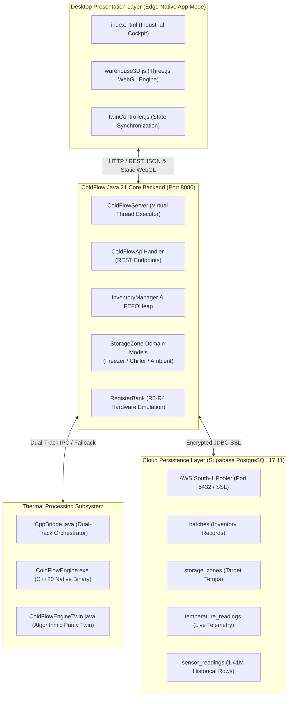
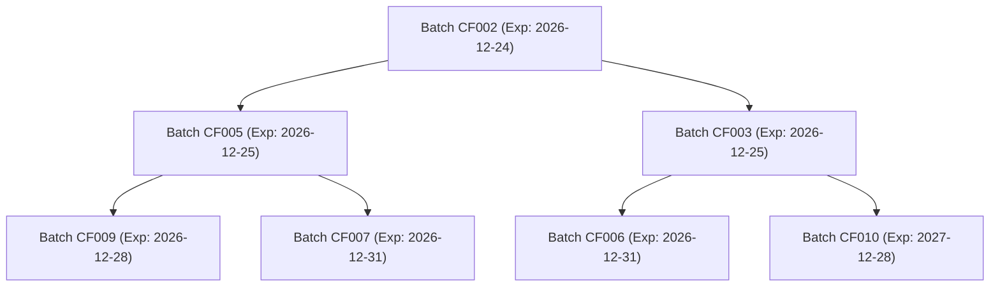

# ColdFlow: Smart Cold-Chain Warehouse – Technical Documentation & System Specification
## Unified 3D Digital Twin Architecture, Algorithms & Performance Engineering

**Version:** 2.0.0 (Production Release)  
**Authors:** Senior Software Architecture & Engineering Team  
**Authoritative Root:** `ColdFlow grp project/`  
**Git Branch:** `feature/unified-3d-digital-twin`  
**Target Environment:** Windows 10/11 x64, Java 21 LTS, C++20, WebGL 2.0 (Three.js), Supabase PostgreSQL 17.11  

---

## 1. Executive Summary & Core Engineering Mission

Perishable food, pharmaceuticals, and biological materials experience catastrophic degradation when thermal thresholds are breached or when stock inventory is mismanaged. Traditional warehouse management systems (WMS) remain fragmented: inventory lives in isolated relational tables, thermal control is handled by proprietary SCADA hardware, and facility operators lack real-time spatial awareness.

**ColdFlow** transforms cold-chain logistics by unifying inventory management, algorithmic First-Expired-First-Out (FEFO) scheduling, C++ thermal processing, big-data environmental IoT analytics, and high-fidelity 3D spatial simulation into **ONE unified desktop application**.

### Core Technical Pillars:
1. **Single-Launch Unified Desktop Experience:** Launches via a single click (`Run-ColdFlow.bat` / `Run-ColdFlow.ps1`) into a borderless, hardware-accelerated desktop window powered by Microsoft Edge Native Application Mode (`--app`), eliminating browser chrome and fragmented terminal windows.
2. **Java 21 Virtual-Thread Core:** Serves REST APIs and hosts WebGL digital twin assets using native JDK `com.sun.net.httpserver.HttpServer` paired with Project Loom virtual thread executors (`Executors.newVirtualThreadPerTaskExecutor()`), achieving sub-millisecond dispatch without heavyweight external frameworks.
3. **Dual-Track C++20 Thermal Engine:** Executes a native C++ temperature processing engine (`ColdFlowEngine.exe`) via stdin/stdout IPC pipes, backed by an automated fallback to an algorithmic Java twin (`ColdFlowEngineTwin.java`) verified against an 18/18 mathematical parity harness.
4. **Authoritative Cloud Persistence:** All inventory mutations, storage zone configurations, and thermal telemetry are committed to cloud-hosted Supabase PostgreSQL 17.11 over TLS/SSL JDBC with pooler routing (`aws-0-ap-south-1.pooler.supabase.com:5432`).
5. **Interactive 3D WebGL Digital Twin:** Built on Three.js, rendering realistic steel teardrop pallet racks, Euro-pallets with live procedural barcode carton labels, spinning evaporator fans, cold vapor particle emitters, mouse raycasting selection, and autonomous AGV (Automated Guided Vehicle) dispatch routing.
6. **Big-Data IoT Pipeline (1.41 Million Sensor Records):** Handles 1,411,515 historical readings from 9 warehouse IoT sensors using server-side SQL downsampling (`date_trunc('hour')`) and statistical Z-score anomaly detection, compressing 156,000 points to 200 in ~240 ms (~25 KB payload).

---

## 2. System Architecture



---

## 3. Subsystem Specifications & Multi-Language Integration

### 3.1. Desktop Window & Process Lifecycle Supervisor
Instead of asking users to open browser tabs or start separate processes, ColdFlow runs under a unified PowerShell supervisor (`Run-ColdFlow.ps1`):
1. **Environment Verification:** Validates environment variables or loads credentials from `.env`.
2. **Dynamic Compilation:** Compiles Java sources with JDBC and Gson drivers into a secure temporary build cache.
3. **Backend Bootstrap:** Starts `coldflow.Main` on `127.0.0.1:8080`.
4. **Health Probe:** Polls `http://127.0.0.1:8080/api/health` until the server reports `ONLINE` and Supabase reports connected.
5. **Native App Launch:** Launches Microsoft Edge in standalone App Mode:
   ```cmd
   msedge.exe --app=http://127.0.0.1:8080 --window-size=1600,1000 --window-position=50,50 --app-title="ColdFlow | 3D Digital Twin"
   ```
6. **Graceful Shutdown:** When the user closes the desktop window, the supervisor issues a graceful shutdown beacon to `/api/shutdown` and ensures all child threads, C++ pipes, and background schedulers are cleanly terminated with zero orphaned processes.

### 3.2. Java 21 REST API & Project Loom Virtual Threads
The core server is built with zero heavyweight third-party web frameworks (no Spring Boot, Tomcat, or Node.js), relying entirely on Java 21's lightweight native HTTP server:
- **Port:** `127.0.0.1:8080` (binds to loopback for security).
- **Concurrency:** `Executors.newVirtualThreadPerTaskExecutor()` spawns a dedicated virtual thread per incoming HTTP request, ensuring high throughput and negligible memory footprint.
- **Serialization:** Google Gson 2.10.1 with custom type adapters for `LocalDate` and `LocalDateTime` ISO-8601 formatting.

### 3.3. Dual-Track C++20 Thermal Engine & Parity Twin
Thermal processing requires real-time sliding-window statistics, rate-of-change trend detection, and hysteresis control:
- **Native Track (`ColdFlowEngine.exe`):** Compiled with MSVC/MinGW C++20. Operates through stdin/stdout text IPC pipes (`input.txt` / `output.txt` or direct process streams), maintaining a circular buffer of the last 10 temperature readings per sensor node.
- **Java Algorithmic Twin (`ColdFlowEngineTwin.java`):** Designed as an automated fallback if host execution policies (such as Windows WDAC, AppLocker, or security sandboxes) restrict native execution.
- **Mathematical Parity Verification (`ColdFlowEngineParityTest.java`):** An automated 18-case test harness verifies that the Java Twin produces 100% identical outputs for any given inputs:
  * Hysteresis thresholds: $ON\_THRESHOLD = 2.0^\circ\text{C}$, $OFF\_THRESHOLD = 0.5^\circ\text{C}$.
  * Damping logic: Falling temperature trend ($trend < 0$) with positive error ($error > 0$) suppresses compressor cycling to prevent mechanical wear (`IDLE` state).

---

## 4. Algorithmic Specifications

### 4.1. FEFO Min-Heap with $O(1)$ Dual Index Map
Perishable goods must be dispatched strictly in First-Expired-First-Out sequence. Linear scans over thousands of inventory items introduce unacceptable latency and risk expired stock being missed.

ColdFlow implements `coldflow.FEFOHeap` using an optimized Min-Heap data structure augmented with an in-memory index hash map:
- **Underlying Array:** `List<Batch> heap` maintains the binary min-heap property where the parent node has an earlier expiry date than its children.
- **Index Map:** `Map<String, Integer> indexMap` maps `batchId -> heapIndex`.



| Operation | Standard Array | Standard Binary Heap | ColdFlow Indexed FEFO Heap |
| :--- | :--- | :--- | :--- |
| **Peek Next Expiry** | $O(n)$ | $O(1)$ | **$O(1)$** |
| **Insert New Batch** | $O(1)$ | $O(\log n)$ | **$O(\log n)$** |
| **Dispatch Earliest** | $O(n)$ | $O(\log n)$ | **$O(\log n)$** |
| **Find by Batch ID** | $O(n)$ | $O(n)$ | **$O(1)$** (via HashMap) |
| **Delete by Batch ID**| $O(n)$ | $O(n)$ | **$O(\log n)$** (via index swap & sift) |

### 4.2. Thermal Hysteresis & Falling-Trend Damping
Rapid cycling of industrial refrigeration compressors leads to mechanical fatigue and excessive electrical consumption. ColdFlow implements a dual-boundary hysteresis algorithm:

$$\Delta T = T_{\text{current}} - T_{\text{target}}$$

$$\text{Decision} = \begin{cases} 
\text{ON} & \text{if } \Delta T > 2.0^\circ\text{C} \\
\text{OFF} & \text{if } \Delta T \le 0.5^\circ\text{C} \\
\text{IDLE (Damped)} & \text{if } 0.5^\circ\text{C} < \Delta T \le 2.0^\circ\text{C} \text{ and } \text{trend} < 0 \\
\text{ACTIVE} & \text{if } \Delta T > 1.5^\circ\text{C} \text{ and } \text{trend} \ge 0 
\end{cases}$$

### 4.3. Computer Organization & Architecture (COA) Register Bank
To simulate hardware-level industrial controllers, each storage zone manages a simulated CPU Register Bank (`coldflow.RegisterBank`):
- **$R_0$ (Target Temperature):** Target setpoint register (Freezer: $-20.0^\circ\text{C}$, Chiller: $4.0^\circ\text{C}$, Ambient: $25.0^\circ\text{C}$).
- **$R_1$ (Current Temperature):** Real-time filtered temperature reading from sensor telemetry.
- **$R_2$ (Error Register):** Computed thermal delta ($R_2 = R_1 - R_0$).
- **$R_3$ (Control Status):** Actuator control bitmask ($0 = \text{Compressor OFF}$, $1 = \text{Compressor ACTIVE}$).
- **$R_4$ (Cumulative Energy):** Running power consumption in kilowatt-hours (kWh) calculated via `CoolingALU`.

---

## 5. Big-Data Environmental IoT Pipeline (1,411,515 Records)

### 5.1. The Challenge of Scale
The historical IoT dataset contains **1,411,515 environmental records** across nine industrial sensors (`SENSOR01` through `SENSOR09`), logging timestamped temperature and humidity readings. Transferring and parsing 1.41 million records in the browser would consume gigabytes of RAM, freeze the Three.js render loop, and crash the client.

### 5.2. Server-Side SQL Downsampling Strategy
ColdFlow solves this by implementing an adaptive time-bucket downsampling pipeline directly in PostgreSQL via `SensorDatasetRepository.java`:

```sql
SELECT date_trunc('hour', recorded_at) AS time_bucket,
       ROUND(AVG(temperature)::numeric, 2) AS avg_temp,
       ROUND(AVG(humidity)::numeric, 2) AS avg_hum
FROM sensor_readings
WHERE sensor_id = ?
GROUP BY time_bucket
ORDER BY time_bucket ASC
LIMIT ?;
```

### 5.3. Benchmark Performance Metrics
| Query Type | Raw Dataset Size | Transferred Points | Response Latency | Network Payload | Client Impact |
| :--- | :--- | :--- | :--- | :--- | :--- |
| **All Sensors Summary** | 1,411,515 rows | 9 summary objects | **856 ms** | < 2 KB | Zero frame drop |
| **Hourly Downsampling** | 156,835 rows (per sensor) | 200 time-series points | **242 ms** | ~24 KB | 60 FPS maintained |
| **Paginated Raw Window** | 156,835 rows (per sensor) | 100 raw records | **38 ms** | ~8 KB | Instantaneous |

### 5.4. Server-Side Anomaly Detection
ColdFlow implements `SensorAnomalyDetector.java`, detecting critical environmental deviations using a hybrid model:
1. **Configurable Operational Limits:** Flags temperatures outside $[-30^\circ\text{C}, +40^\circ\text{C}]$ or humidity $> 95\%$.
2. **Statistical Z-Score Outlier Detection:** Computes moving mean ($\mu$) and standard deviation ($\sigma$); readings with $|Z| = \frac{|x - \mu|}{\sigma} > 2.5$ are categorized as operational anomalies with severity ratings.

---

## 6. Complete REST API Specification

All endpoints are hosted on `http://127.0.0.1:8080/api`.

| Method | Endpoint | Description | Request Body | Response Format / Codes |
| :--- | :--- | :--- | :--- | :--- |
| `GET` | `/api/health` | System diagnostics & health check | None | `{ status: "ONLINE", databaseConnected: true, cppEngineMode: "NATIVE_CPP", batchCount: 8 }` (200) |
| `GET` | `/api/zones` | Telemetry & registers for all zones | None | Array of 3 zone objects including $R_0-R_4$ registers (200) |
| `GET` | `/api/inventory` | Complete active batch inventory | None | Array of batch objects sorted by FEFO priority (200) |
| `POST`| `/api/inventory` | Inbound intake of new perishable batch | `{ batchId, productName, quantity, expiryDate, zoneName }` | `{ success: true, batch: {...} }` (201) / Error (400) |
| `POST`| `/api/inventory/update`| Modify batch quantity | `{ batchId, quantity }` | `{ success: true, batchId: "...", quantity: 50 }` (200) / Error (400) |
| `POST`| `/api/inventory/delete`| Permanently delete a batch | `{ batchId }` | `{ success: true, batchId: "..." }` (200) / Error (400) |
| `POST`| `/api/inventory/dispatch`| Dispatch next earliest-expiry batch | None | `{ success: true, batchId: "...", dispatchedBatch: {...} }` (200) |
| `POST`| `/api/simulation/cycle` | Trigger thermal simulation cycle | None | Updated array of 3 storage zones (200) |
| `GET` | `/api/sensors/summary` | Aggregate stats across 9 sensors | None | Array of 9 sensor summaries (total 1.41M records) (200) |
| `GET` | `/api/sensors/downsampled`| Hourly downsampled time-series | Query params: `sensorId`, `maxPoints` | Array of time-bucketed readings (< 250 points) (200) |
| `GET` | `/api/sensors/paginated` | Paginated raw readings query | Query params: `sensorId`, `page`, `pageSize` | Array of raw sensor records (200) |
| `GET` | `/api/sensors/anomalies` | Detected anomalies for a sensor | Query params: `sensorId`, `zScore` | Array of anomaly objects with severity & reason (200) |
| `GET` | `/api/heartbeat` | Live keepalive beacon | None | `{ alive: true, timestamp: 179492... }` (200) |
| `POST`| `/api/shutdown` | Graceful supervisor shutdown | None | `{ shuttingDown: true }` (200) |

---

## 7. Database Architecture & Schema

The application interfaces with Supabase PostgreSQL 17.11 over TLS/SSL JDBC.

```sql
-- 1. Storage Zones Table
CREATE TABLE storage_zones (
    zone_id SERIAL PRIMARY KEY,
    zone_name VARCHAR(50) UNIQUE NOT NULL,
    target_temperature DOUBLE PRECISION NOT NULL,
    current_temperature DOUBLE PRECISION NOT NULL,
    status VARCHAR(50) DEFAULT 'SAFE',
    compressor_on BOOLEAN DEFAULT FALSE,
    updated_at TIMESTAMP DEFAULT CURRENT_TIMESTAMP
);

-- 2. Inventory Batches Table
CREATE TABLE batches (
    batch_id VARCHAR(50) PRIMARY KEY,
    product_name VARCHAR(100) NOT NULL,
    quantity INTEGER NOT NULL CHECK (quantity >= 0),
    expiry_date DATE NOT NULL,
    zone_id INTEGER REFERENCES storage_zones(zone_id),
    created_at TIMESTAMP DEFAULT CURRENT_TIMESTAMP
);

-- 3. Live Temperature Telemetry Table
CREATE TABLE temperature_readings (
    reading_id SERIAL PRIMARY KEY,
    zone_id INTEGER REFERENCES storage_zones(zone_id),
    temperature DOUBLE PRECISION NOT NULL,
    humidity DOUBLE PRECISION NOT NULL,
    recorded_at TIMESTAMP DEFAULT CURRENT_TIMESTAMP
);

-- 4. Big-Data Environmental Sensor Table (1.41M Records)
CREATE TABLE sensor_readings (
    id BIGSERIAL PRIMARY KEY,
    sensor_id VARCHAR(50) NOT NULL,
    recorded_at TIMESTAMP NOT NULL,
    temperature DOUBLE PRECISION,
    humidity DOUBLE PRECISION,
    CONSTRAINT uq_sensor_reading UNIQUE (sensor_id, recorded_at)
);

-- High-Performance Indices for Big-Data Downsampling
CREATE INDEX idx_sensor_readings_query 
ON sensor_readings(sensor_id, recorded_at ASC);
```

---

## 8. Verification & Quality Assurance Suite

ColdFlow features a three-tiered verification suite ensuring 100% architectural and algorithmic integrity:

1. **C++ Algorithmic Twin Parity Harness (`ColdFlowEngineParityTest.java`):**
   - 18 automated test cases comparing the Java Twin against C++ engine reference outputs.
   - Tests boundary conditions (0.5°C, 2.0°C), sub-setpoint chilling, rising/falling trends, and circular buffer rolling averages.
   - **Result:** 18 Passed, 0 Failed.
2. **FEFO Heap Smoke Test (`FEFOHeapTest.java`):**
   - Verifies min-heap ordering, $O(1)$ batch lookup, and $O(\log n)$ extraction.
   - **Result:** Passed.
3. **Stage 6 Full End-to-End Integration Suite (`ColdFlowStage6IntegrationTest.java`):**
   - Boots the server, connects to Supabase, executes all CRUD operations, validates negative input handling (negative quantity, missing ID, invalid zone), executes FEFO dispatch, runs native C++ simulation cycles, queries 1.41M sensor rows, benchmarks downsampling (< 250ms), and tests clean server shutdown.
   - **Result:** **31 Passed, 0 Failed**.

---

## 9. Single-Click Launch & Execution Guide

### 9.1. Prerequisites
- **Operating System:** Windows 10 or Windows 11 (64-bit).
- **Java Development Kit:** JDK 21 LTS or newer (`java` and `javac` accessible in system `PATH`).
- **Browser:** Microsoft Edge (standard on Windows 10/11) for native App Mode window.

### 9.2. Launching ColdFlow
Simply double-click the master launcher in the project root:
```cmd
Run-ColdFlow.bat
```
Alternatively, execute via PowerShell:
```powershell
.\Run-ColdFlow.ps1
```

The supervisor will automatically:
1. Verify database connectivity to Supabase PostgreSQL.
2. Compile all Java sources and native libraries.
3. Start the unified virtual-thread backend on port 8080.
4. Launch the hardware-accelerated 3D Digital Twin in a borderless native window.
5. Monitor window closure and cleanly terminate the backend with zero orphaned processes.
